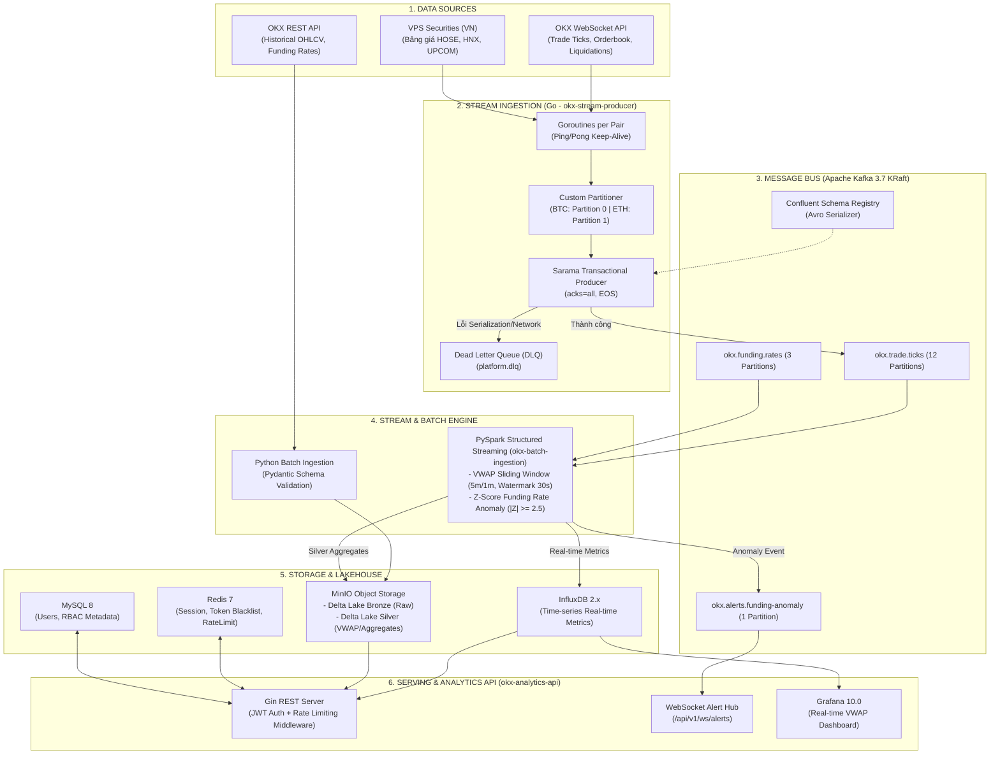

# SỔ TAY DATAOPS & FINANCIAL BACKEND TRADING (ZERO-TO-HERO HANDBOOK)
> **Dành riêng cho Fresher**: Hướng dẫn chi tiết từ bản chất học thuật, nguyên lý hệ thống phân tán đến cách áp dụng thực chiến trong dự án `DataOps_Backend_Financial_Trading`.
> 
> *Tài liệu được biên soạn dựa trên các nguyên tắc chuẩn của Martin Kleppmann (Designing Data-Intensive Applications), O'Reilly Software Architecture, và kiến trúc thực tế của dự án.*

---

## MỤC LỤC TỔNG QUAN

1. [Bản đồ Kiến trúc Toàn diện (System High-Level Architecture)](#1-bản-đồ-kiến-trúc-toàn-diện)
2. [Golang 1.22: Trái tim của Hệ thống Tốc độ cao](#2-golang-122-trái-tim-của-hệ-thống-tốc-độ-cao)
3. [WebSocket: Kết nối Sàn Giao dịch Thời gian thực (Zero Polling Overhead)](#3-websocket-kết-nối-sàn-giao-dịch-thời-gian-thực)
4. [Apache Kafka (KRaft Mode): Xương sống Truyền tin Phân tán](#4-apache-kafka-kraft-mode-xương-sống-truyền-tin-phân-tán)
5. [Apache Avro & Schema Registry: Chuẩn hóa Hợp đồng Dữ liệu](#5-apache-avro--schema-registry-chuẩn-hóa-hợp-đồng-dữ-liệu)
6. [PySpark Structured Streaming: Xử lý Dữ liệu Luồng Quy mô lớn](#6-pyspark-structured-streaming-xử-lý-dữ-liệu-luồng-quy-mô-lớn)
7. [Apache Flink: Xử lý Luồng Độ trễ Siêu thấp (So sánh với Spark)](#7-apache-flink-xử-lý-luồng-độ-trễ-siêu-thấp)
8. [MinIO & Delta Lake (Lakehouse Architecture)](#8-minio--delta-lake-lakehouse-architecture)
9. [REST API (Gin Framework) & gRPC: Phục vụ Truy vấn](#9-rest-api-gin-framework--grpc-phục-vụ-truy-vấn)
10. [JWT Authentication & Exchange Security (HMAC SHA-256)](#10-jwt-authentication--exchange-security-hmac-sha-256)
11. [Docker & Container Orchestration: Đóng gói Chuẩn Production](#11-docker--container-orchestration-đóng-gói-chuẩn-production)
12. [Cẩm nang Debug dành cho Fresher: Từ Lỗi Thường gặp đến Root Cause](#12-cẩm-nang-debug-dành-cho-fresher)

---

## 1. BẢN ĐỒ KIẾN TRÚC TOÀN DIỆN



---

## 2. GOLANG 1.22: TRÁI TIM CỦA HỆ THỐNG TỐC ĐỘ CAO

### 2.1 Bản chất học thuật: Tại sao chọn Go cho Trading?
1. **Mô hình Concurrency CSP (Communicating Sequential Processes):**
   - Thay vì dùng OS Thread nặng nề (~1MB đến 8MB bộ nhớ stack/thread), Go sử dụng **Goroutine** siêu nhẹ (chỉ tốn ~2KB ban đầu, tự co giãn).
   - Trong hệ thống tài chính với hàng trăm cặp tiền điện tử và cổ phiếu, việc mở 1.000 Goroutine lắng nghe song song tiêu tốn chưa đến 5MB RAM, trong khi Java hay C++ sẽ tốn hàng GB.
2. **Garbage Collector (GC) độ trễ thấp:**
   - Go tối ưu GC dừng chương trình (Stop-the-World) dưới **1 millisecond**, tránh hiện tượng giật cục (latency spike) gây trượt giá (slippage) khi bắt tick giao dịch.

### 2.2 Cách áp dụng trong project & Giải thích Code
Nhìn vào [`okx-stream-producer/pkg/producer/transactional_producer.go`](okx-stream-producer/pkg/producer/transactional_producer.go:1):

```go
// TẠI SAO PHẢI VIẾT NHƯ THẾ NÀY?
config.Producer.RequiredAcks = sarama.WaitForAll // acks=all
config.Net.MaxOpenRequests = 1                    // Bắt buộc cho Idempotent/Transactional
config.Producer.Idempotent = true
config.Producer.Transaction.ID = transactionalID
```
* **Giải thích nguyên lý:**
  - `RequiredAcks = WaitForAll` (`acks=all`): Producer bắt buộc tất cả bản sao (In-Sync Replicas - ISR) trong Kafka phải ghi tin nhắn vào ổ cứng trước khi phản hồi thành công. Điều này đảm bảo **Zero Message Loss** ngay cả khi broker leader bị sập.
  - `MaxOpenRequests = 1` & `Idempotent = true`: Đảm bảo khi mạng bị chập chờn và Producer gửi lại (retry), Kafka sẽ tự động nhận diện `ProducerID + SequenceNumber` để loại bỏ tin nhắn trùng lặp, giữ đúng thứ tự khớp lệnh từng microsecond.

---

## 3. WEBSOCKET: KẾT NỐI SÀN GIAO DỊCH THỜI GIAN THỰC

### 3.1 Bản chất: WebSocket vs REST Polling
- **HTTP REST Polling:** Client liên tục gửi `GET /ticker` mỗi giây $\rightarrow$ Tạo ra hàng ngàn gói tin TCP handshake 3 bước và HTTP header nặng nề $\rightarrow$ lãng phí băng thông, độ trễ tối thiểu 200ms - 500ms.
- **WebSocket (RFC 6455):** Khởi tạo bằng HTTP Upgrade, sau đó nâng cấp thành kết nối **Full-Duplex (2 chiều liên tục)** trên một kết nối TCP duy nhất. Khi sàn có 1 lệnh khớp (match), sàn chủ động "bắn" byte dữ liệu về máy chủ trong vòng **5ms - 15ms**.

### 3.2 Cách áp dụng trong project
Nhìn vào [`okx-stream-producer/pkg/sources/okx/websocket/producer.go`](okx-stream-producer/pkg/sources/okx/websocket/producer.go:1):
* **Cơ chế Ping/Pong Heartbeat:** Định kỳ 20 giây gửi message `{"op":"ping"}` để tránh tường lửa và load balancer ngắt kết nối idle TCP.
* **Tự động Reconnect (Exponential Backoff):** Nếu mạng rớt, producer không crash mà tự động ngủ `1s, 2s, 4s...` rồi kết nối lại và subscribe lại toàn bộ danh sách coin.

---

## 4. APACHE KAFKA (KRAFT MODE): XƯƠNG SỐNG TRUYỀN TIN PHÂN TÁN

### 4.1 Khái niệm & Nguyên lý hoạt động
1. **KRaft Mode (Kafka Raft Metadata Mode):**
   - Phiên bản Kafka 3.x loại bỏ hoàn toàn dependency bên ngoài là ZooKeeper. Metadata cluster được đồng thuận trực tiếp qua thuật toán Raft giữa các broker $\rightarrow$ Khởi động cực nhanh, quản lý hàng triệu partition mà không bị nghẽn ZooKeeper.
2. **Topic, Partition và Consumer Group:**
   - **Topic:** Kênh chứa dữ liệu (vd: `okx.trade.ticks`).
   - **Partition:** Chia nhỏ Topic ra nhiều file log tuần tự (Append-only Log). Mỗi partition chỉ có 1 Consumer trong cùng 1 Consumer Group được đọc tại 1 thời điểm $\rightarrow$ Đảm bảo thứ tự tuyệt đối trên từng Partition.

### 4.2 Giải thích thiết kế Custom Partitioner trong dự án
Nhìn vào [`okx-stream-producer/pkg/producer/transactional_producer.go`](okx-stream-producer/pkg/producer/transactional_producer.go:18):
```go
func (p *OKXPartitioner) Partition(msg *sarama.ProducerMessage, numPartitions int32) (int32, error) {
    symbol := string(keyBytes)
    if strings.HasPrefix(symbol, "BTC") {
        return 0, nil // Partition 0 dành riêng cho BTC
    }
    if strings.HasPrefix(symbol, "ETH") {
        return 1, nil // Partition 1 dành riêng cho ETH
    }
    // Các coin khác hash vào các partition còn lại (2 -> N-1)
    hasher := fnv.New32a()
    hasher.Write(keyBytes)
    return int32(hasher.Sum32()%(uint32(numPartitions)-2)) + 2, nil
}
```
* **Tại sao làm vậy?** 
  BTC và ETH chiếm tới **70% tổng volume giao dịch**. Nếu để Kafka hash ngẫu nhiên, tick của BTC sẽ làm nghẽn các coin nhỏ (hiện tượng Head-of-Line Blocking). Tách riêng Partition 0 cho BTC và Partition 1 cho ETH giúp tăng throughput và đảm bảo latency ổn định.

---

## 5. APACHE AVRO & SCHEMA REGISTRY: CHUẨN HÓA HỢP ĐỒNG DỮ LIỆU

### 5.1 So sánh Avro vs JSON vs Protobuf

| Đặc điểm | JSON | Protobuf | Apache Avro |
| :--- | :--- | :--- | :--- |
| **Định dạng** | Text (chuỗi đọc được) | Nhị phân (Binary) | Nhị phân (Binary) |
| **Kích thước payload** | Lớn (chứa kèm key name) | Nhỏ (~20-30% JSON) | Rất nhỏ (~15-25% JSON) |
| **Schema Evolution** | Thủ công | Qua Tag number (1, 2) | Schema Registry (Full compatibility) |
| **Sử dụng tối ưu** | REST API / Frontend | Microservice gRPC nội bộ | **Data Streaming Kafka + Big Data** |

### 5.2 Cách hoạt động trong dự án
1. Schema được định nghĩa trong [`okx-stream-producer/pkg/schemas/okx_trade_event.avsc`](okx-stream-producer/pkg/schemas/okx_trade_event.avsc:1).
2. Khi Producer gửi message, nó không gửi lại toàn bộ tên trường JSON `"price"`, `"volume"`. Thay vào đó, nó đăng ký schema lên **Confluent Schema Registry**, lấy về `Schema ID = 1`.
3. Message gửi vào Kafka có cấu trúc Confluent Wire Format (5 bytes header):
   `[Magic Byte (0x00)] + [4 Bytes Schema ID] + [Binary Payload]`
   $\rightarrow$ Tiết kiệm hàng Terabyte băng thông mạng mỗi ngày.

---

## 6. PYSPARK STRUCTURED STREAMING: XỬ LÝ DỮ LIỆU LUỒNG QUY MÔ LỚN

### 6.1 Bản chất: Micro-batching & Event-Time Processing
- **Event-Time vs Processing-Time:**
  - *Processing-Time:* Giờ máy chủ Spark nhận được tin nhắn (sai lệch nếu mạng chậm).
  - *Event-Time:* Giờ lệnh khớp thực tế tại máy chủ sàn OKX (`ts` đính kèm trong tick).
- **Watermark:** Cơ chế cho phép Spark chờ các tick đến muộn (Late Data).
  Ví dụ: `withWatermark("event_time", "30 seconds")` nghĩa là nếu một tick của 30 giây trước bây giờ mới tới, Spark vẫn gộp vào tính toán; nhưng nếu trễ hơn 30 giây thì Spark sẽ đóng window và giải phóng RAM.

### 6.2 Giải thích Thuật toán Tài chính trong Code
Nhìn vào [`okx-batch-ingestion/pipeline/spark_jobs.py`](okx-batch-ingestion/pipeline/spark_jobs.py:75):

1. **VWAP (Volume Weighted Average Price) Sliding Window:**
   $$\text{VWAP} = \frac{\sum (\text{Price}_i \times \text{Quantity}_i)}{\sum \text{Quantity}_i}$$
   Window 5 phút, trượt (slide) mỗi 1 phút $\rightarrow$ Cung cấp đường trung bình giá có trọng số khối lượng cực kỳ mượt cho các thuật toán bot giao dịch.
2. **Rolling Z-Score Funding Rate Anomaly:**
   $$Z = \frac{X - \mu}{\sigma} = \frac{\text{Funding Rate} - \text{Mean}_{1\text{h}}}{\text{StdDev}_{1\text{h}}}$$
   Khi $|Z| \ge 2.5$, thị trường đang rơi vào trạng thái tâm lý Long/Short cực đoan bất thường $\rightarrow$ Spark lập tức phát sinh alert event đẩy vào topic `okx.alerts.funding-anomaly`.

---

## 7. APACHE FLINK: XỬ LÝ LUỒNG ĐỘ TRỄ SIÊU THẤP

### 7.1 So sánh chuyên sâu: Flink vs PySpark

| Tiêu chí | Apache Spark (Structured Streaming) | Apache Flink |
| :--- | :--- | :--- |
| **Mô hình xử lý** | Micro-batch (Gom từng mẻ nhỏ, vd: 100ms - 1s) | **Native Event-driven (Từng record một - True Streaming)** |
| **Độ trễ (Latency)** | ~50ms - 500ms (Phù hợp VWAP, Batch, Lakehouse) | **< 5ms - 10ms (Phù hợp High Frequency Trading HFT)** |
| **State Backend** | In-Memory, Checkpoint HDFS/S3 | RocksDB (Xử lý State hàng Terabyte với độ trễ cực thấp) |
| **Dự án hiện tại** | Dùng Spark cho Ingestion, VWAP 5m, Delta Lake | Sẵn sàng mở rộng Flink khi cần Bot cắt lỗ tức thời (<10ms) |

---

## 8. MINIO & DELTA LAKE (LAKEHOUSE ARCHITECTURE)

### 8.1 Tại sao không dùng Database truyền thống để lưu Tick Data?
- Thị trường giao dịch tạo ra **hàng trăm triệu bản ghi mỗi ngày**. Nếu lưu vào MySQL/PostgreSQL, bảng sẽ phình to hàng trăm GB $\rightarrow$ Index sập, query scan chậm hàng chục phút, chi phí đắt đỏ.
- **Lakehouse Architecture:** Sử dụng Object Storage rẻ tiền (**MinIO / S3**) kết hợp định dạng **Delta Lake (ACID trên file Parquet)**.

### 8.2 Kiến trúc Medallion (Bronze $\rightarrow$ Silver $\rightarrow$ Gold)
1. **Bronze Layer (`s3a://okx-delta/bronze/`):**
   - Chứa dữ liệu thô (Raw data) từ REST API và Kafka Connect.
   - Partition theo `symbol/date` $\rightarrow$ Đảm bảo tính Idempotent (chạy lại pipeline không bị duplicate).
2. **Silver Layer (`s3a://okx-delta/silver/`):**
   - Dữ liệu đã được Spark làm sạch, tính toán VWAP, loại bỏ duplicate, chuẩn hóa timestamp.
3. **Gold Layer (InfluxDB / Data Mart):**
   - Dữ liệu tổng hợp mức cao sẵn sàng cho BI, Grafana và Analytics API phục vụ người dùng.

---

## 9. REST API (GIN FRAMEWORK) & GRPC: PHỤC VỤ TRUY VẤN

### 9.1 REST vs gRPC trong dự án
- **REST (HTTP/JSON qua Gin):** Sử dụng cho tầng Public Facing (Client Mobile/Web, Login, xem biểu đồ VWAP) vì tính tương thích cao và dễ tích hợp.
- **gRPC (HTTP/2 + Protobuf):** Sử dụng giữa các service nội bộ backend (`okx-stream-producer` $\leftrightarrow$ `okx-analytics-api`) để đạt tốc độ serialize siêu tốc và stream 2 chiều.

### 9.2 Rate Limiting & Token Bucket Algorithm
Nhìn vào [`okx-analytics-api/middlewares/rate_limiter.go`](okx-analytics-api/middlewares/rate_limiter.go:1):
* Sử dụng Redis atomic counter (`INCR` + `EXPIRE`) để giới hạn số lượt gọi API của từng IP/User (vd: tối đa 60 req/phút) $\rightarrow$ Ngăn chặn tấn công DDoS làm tê liệt database.

---

## 10. JWT AUTHENTICATION & EXCHANGE SECURITY (HMAC SHA-256)

### 10.1 JWT Role-Based Access Control (RBAC) & Redis Blacklist
Nhìn vào [`okx-analytics-api/middlewares/jwt_auth.go`](okx-analytics-api/middlewares/jwt_auth.go:1):
1. **Stateless Authentication:** Người dùng gửi `{username, password}` $\rightarrow$ Server cấp JWT Token chứa claims `{user_id, role, exp}` ký bằng thuật toán HS256.
2. **Instant Revocation (Thu hồi token lập tức):** Điểm yếu của JWT là không thể hủy trước hạn. Dự án giải quyết bằng cách lưu token bị logout vào **Redis Blacklist** với TTL bằng thời gian sống còn lại của token.

### 10.2 Ký xác thực API Sàn OKX (HMAC SHA-256)
Nhìn vào [`okx-stream-producer/pkg/sources/okx/auth.go`](okx-stream-producer/pkg/sources/okx/auth.go:1):
```go
// Công thức ký bắt buộc của OKX:
// Signature = Base64(HMAC-SHA256(SecretKey, Timestamp + Method + RequestPath + Body))
```
* **Mục đích:** Đảm bảo gói tin không bị sửa đổi trên đường truyền (Integrity) và chống tấn công Replay Attack (nhờ kiểm tra `Timestamp` trong khoảng $\pm 30$ giây).

---

## 11. DOCKER & CONTAINER ORCHESTRATION: ĐÓNG GÓI CHUẨN PRODUCTION

### 11.1 Cấu trúc Orchestration trong [`docker-compose.yml`](docker-compose.yml:1)
1. **Kafka KRaft Cluster HA:** Gồm 3 brokers (`kafka1`, `kafka2`, `kafka3`) chạy chế độ Controller + Broker. Cấu hình `min.insync.replicas=2` và `unclean.leader.election.enable=false` $\rightarrow$ Đảm bảo an toàn dữ liệu tuyệt đối.
2. **MinIO (S3 API):** Cung cấp storage cục bộ cho Delta Lake.
3. **InfluxDB 2.x:** Lưu trữ Time-series metrics tốc độ cao.
4. **Redis 7 & MySQL 8:** Cung cấp cache session và dữ liệu quan hệ người dùng.

---

## 12. CẨM NANG DEBUG DÀNH CHO FRESHER: TỪ LỖI THƯỜNG GẶP ĐẾN ROOT CAUSE

Khi gặp sự cố trong hệ thống, hãy tra cứu nhanh theo bảng sau:

| Hiện tượng lỗi | Root Cause (Nguyên nhân gốc rễ) | Vị trí kiểm tra & Cách khắc phục |
| :--- | :--- | :--- |
| **OKX WS trả về lỗi 401 / 4001** | Sai API Key, Passphrase hoặc đồng hồ máy tính bị lệch quá 30 giây. | Kiểm tra NTP Time Sync của Windows/Linux: `w32tm /resync`. Kiểm tra lại `.env`. |
| **Kafka báo `LeaderNotAvailableException`** | Broker leader của partition vừa bị ngắt hoặc đang bầu lại Leader. | Đợi 3-5s để KRaft Raft Consensus bầu leader mới; kiểm tra retry policy trong Go. |
| **Spark Streaming không thấy dữ liệu mới** | Watermark 30s đang loại bỏ các message có `event_time` quá cũ (do lag mạng). | Kiểm tra trường `ts` trong producer. Tăng tạm thời watermark lên `2 minutes` để test. |
| **MinIO báo lỗi `SignatureDoesNotMatch`** | Sai AccessKey hoặc SecretKey của MinIO trong biến môi trường Spark. | Kiểm tra `spark.hadoop.fs.s3a.access.key` và `.secret.key` trong `spark_jobs.py`. |
| **API trả về 429 Too Many Requests** | IP của bạn đã vượt quá giới hạn cấu hình trong Rate Limiter. | Kiểm tra Redis key `ratelimit:<IP>:<window>` hoặc nới rộng limit trong middleware. |
| **DLQ Topic (`platform.dlq`) có message** | Message gửi lên Kafka sai định dạng JSON/Avro hoặc bị mất trường bắt buộc. | Đọc header `failure-reason` của message trong Kafka UI để xem stack trace chi tiết. |

---

*Tài liệu thuộc quyền sở hữu của dự án DataOps Backend Financial Trading. Mọi thắc mắc hoặc cập nhật mới cần đối chiếu với [`STAGE_DEBUG_GUIDE.md`](STAGE_DEBUG_GUIDE.md:1) và [`OKX_CRYPTO_PLATFORM_DESIGN.md`](OKX_CRYPTO_PLATFORM_DESIGN.md:1).*
