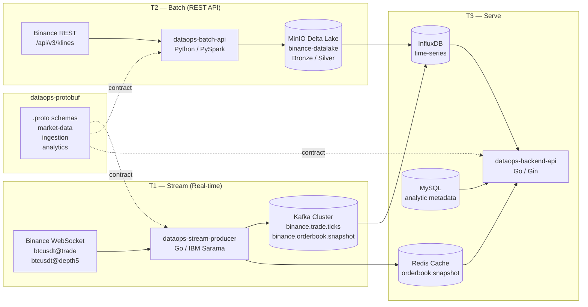

# HƯỚNG DẪN INFRA DOCKER-COMPOSE, TEST SERVICES VÀ CÀI ĐẶT GOLANG TRÊN UBUNTU

## PHẦN 1: CÀI ĐẶT GOLANG TRÊN UBUNTU

### Cách 1: Cài đặt từ Official Tarball (Khuyên dùng - Chuẩn nhất cho Developer)
---
---
---
---
```bash
# 1. Cập nhật hệ thống và cài đặt công cụ cần thiết
sudo apt update && sudo apt upgrade -y
sudo apt install -y curl wget tar git

# 2. Tải bản Go 1.23.6 (hoặc phiên bản mong muốn)
GO_VERSION="1.27.0"
wget https://go.dev/dl/go${GO_VERSION}.linux-amd64.tar.gz

# 3. Xoá bản cũ và giải nén vào /usr/local
sudo rm -rf /usr/local/go
sudo tar -C /usr/local -xzf go${GO_VERSION}.linux-amd64.tar.gz
rm go${GO_VERSION}.linux-amd64.tar.gz

# 4. Cấu hình biến môi trường
echo 'export PATH=$PATH:/home/hungpham/go/bin' >> ~/.bashrc
echo 'export GOPATH=$HOME/go' >> ~/.bashrc
echo 'export PATH=$PATH:$GOPATH/bin' >> ~/.bashrc
source ~/.bashrc

# 5. Kiểm tra phiên bản
go version
```
---
### Cách 2: Cài đặt nhanh qua Snap
---
---
---
---
```bash
sudo snap install --classic go
go version
```
---
## PHẦN 2: THỨ TỰ BUILD & KHỞI CHẠY INFRA DOCKER-COMPOSE

### Ma trận Port (Đã chuẩn hóa, tránh xung đột)
- **MySQL:** `3306:3306`
- **Redis:** `6379:6379`
- **InfluxDB 2.7:** `8086:8086`
- **MinIO:** `9010:9000` (S3 API), `9011:9001` (Console)
- **Kafka Brokers:** `9092`, `9093`, `9094`
- **Schema Registry:** `8081:8081`
- **Kafka UI:** `8082:8080`
- **Spark Master:** `7087:7077` (RPC), `8095:8080` (Web UI)
- **Grafana:** `3001:3000`
- **dataops-backend-api:** `8080:8080`

### Bước 1: Di chuyển vào thư mục hạ tầng
---
---
---
---
```bash
cd infra_dataops_finance_trading
```
---
### Bước 2: Khởi chạy Layer 1 & Layer 2 (Brokers, Storage, Registry)
---
---
---
---
```bash
# Khởi động cụm Kafka, DB, Redis, InfluxDB, MinIO
docker compose up -d kafka1 kafka2 kafka3 redis mysql influxdb minio

# Khởi động tiếp Schema Registry, Kafka UI, Spark, Grafana
docker compose up -d schema-registry kafka-ui spark-master spark-worker grafana

# Kiểm tra trạng thái container (đảm bảo healthy/running)
docker compose ps
```
---
### Bước 3: Build và khởi chạy Layer 3 (Application Services)
---
---
---
---
```bash
# Build và chạy đồng loạt 3 services
docker compose up -d --build dataops-stream-producer dataops-backend-api dataops-batch-api
```
---
## PHẦN 3: CÁC LỆNH TEST CHI TIẾT TỪNG SERVICE

### 1. Test Storage, Message Broker & Registry
---
---
---
---
```bash
# Kiểm tra danh sách Kafka topics qua CLI
docker compose exec kafka1 kafka-topics --bootstrap-server localhost:9092 --list

# Kiểm tra Redis
docker compose exec redis redis-cli ping

# Kiểm tra MySQL
docker compose exec mysql mysql -u root -p123456 -e "SHOW DATABASES; USE binance_analytics; SHOW TABLES;"


cd ~/DataOps_Backend_Financial_Trading/infra_dataops_finance_trading

# Xóa volume KRaft cũ bị deadlock
docker compose down
docker volume rm infra_dataops_finance_trading_kafka1-data infra_dataops_finance_trading_kafka2-data infra_dataops_finance_trading_kafka3-data 2>/dev/null || true

# Khởi chạy cụm hạ tầng
docker compose up -d schema-registry kafka-ui spark-master spark-worker grafana

# Kiểm tra trạng thái: các container phải Healthy/Up
docker compose ps

docker compose --env-file ../.env up -d --build
# Kiểm tra Web UI:
# - Kafka UI: http://localhost:8082
# - MinIO Console: http://localhost:9011 (minioadmin / minioadmin)
# - Spark Master UI: http://localhost:8095
# - Grafana: http://localhost:3001
```
---
### 2. Test `dataops-stream-producer` (Real-time Stream Ingestion)
---
---
---
---
```bash
# Xem log kết nối WebSocket Binance / Poller TCBS
docker compose logs -f --tail=100 dataops-stream-producer

# Kiểm tra tin nhắn thực tế đổ về Kafka topic
docker compose exec kafka1 kafka-console-consumer \
  --bootstrap-server localhost:9092 \
  --topic binance.trade.ticks \
  --from-beginning \
  --max-messages 5
```
---
### 3. Test `dataops_backend_api` (REST API & Metrics)
---
---
---
---
```bash
# Xem log khởi động Backend API
docker compose logs -f --tail=100 dataops-backend-api

# Kiểm tra Healthcheck
curl -i http://localhost:8080/health

# Kiểm tra Prometheus Metrics
curl -i http://localhost:8080/metrics

# Kiểm tra API Crypto Trade
curl -i http://localhost:8080/api/v1/crypto/trades/BTCUSDT
```
---
### 4. Test `dataops_batch_api` (PySpark & Delta Lake Pipeline)
---
---
---
---
```bash
# Xem log Batch API container
docker compose logs -f --tail=100 dataops-batch-api

# Exec vào container chạy thử bronze flow
docker compose exec dataops-batch-api python -m cli.flows.serving.bronze_flow
```
---
## PHẦN 4: LỆNH DỌN DẸP & RESTART

---
```bash
# Xem log service cụ thể
docker compose logs -f <service_name>

# Rebuild 1 service sau khi sửa code
docker compose up -d --build <service_name>

# Dừng toàn bộ hệ thống
docker compose down

# Dừng và xoá sạch Volumes
docker compose down -v
```
---

Đủ context rồi. Giờ tôi có full picture của cả 4 service. Tổng hợp test plan toàn diện:

---

## Test Plan đầy đủ cho 4 services — Binance data end-to-end

Trước hết, bức tranh toàn cảnh của luồng data:



---

## Bước 0 — Fix infra trước khi test bất cứ thứ gì

**Đây là blocking prerequisite.** Thứ tự phải làm:

### 0.1 Fix docker-compose.yml — Kafka healthcheck

Mở file `infra_dataops_finance_trading/docker-compose.yml`, tìm phần `kafka2` và `kafka3`, sửa healthcheck:

```yaml
# kafka2 — ĐỔI từ:
test: ["CMD", "cub", "kafka-ready", "-b", "localhost:29092", "1", "30"]
# THÀNH:
test: ["CMD", "cub", "kafka-ready", "-b", "kafka2:29092", "1", "30"]

# kafka3 — ĐỔI từ:
test: ["CMD", "cub", "kafka-ready", "-b", "localhost:29092", "1", "30"]
# THÀNH:
test: ["CMD", "cub", "kafka-ready", "-b", "kafka3:29092", "1", "30"]
```

> Bạn cần switch **Agent mode** để tôi sửa trực tiếp file này vì Ask mode không write được.

### 0.2 Sequence restart sau khi sửa docker-compose

```powershell
cd infra_dataops_finance_trading

# 1. Dừng tất cả
docker compose down

# 2. Xóa Kafka volumes (stale KRaft metadata gây DUPLICATE_BROKER_REGISTRATION)
docker volume rm dataops-kafka1-data dataops-kafka2-data dataops-kafka3-data

# 3. Rebuild images (áp dụng fix BUG-1 + BUG-2 đã sửa trong code)
docker compose build dataops-stream-producer dataops-batch-api

# 4. Khởi động Kafka cluster trước — đợi healthy
docker compose up -d kafka1 kafka2 kafka3
Start-Sleep -Seconds 90

# 5. Verify cả 3 healthy (QUAN TRỌNG — không tiếp tục nếu còn unhealthy)
docker compose ps kafka1 kafka2 kafka3

# 6. Khởi động toàn bộ còn lại
docker compose up -d
```

---

## Bước 1 — Test `dataops-stream-producer` (Go WebSocket → Kafka)

**Mục tiêu:** Verify Binance WebSocket data đang chảy vào Kafka topic `binance.trade.ticks`

### 1.1 Kiểm tra service start thành công

```powershell
docker compose logs dataops-stream-producer --tail=30
```

**Log bình thường khi healthy:**
```
[data-stream-producer] Starting
[BinanceProducer] Starting for symbols: [BTCUSDT ETHUSDT SOLUSDT]
[Producer] Initialized with 3 brokers, SchemaRegistry=http://schema-registry:8081
[BinanceProducer] [BTCUSDT] connected to Binance WebSocket
[BinanceProducer] [ETHUSDT] connected to Binance WebSocket
[BinanceProducer] [SOLUSDT] connected to Binance WebSocket
[data-stream-producer] Running — topics: [binance.trade.ticks ...]
```

**Nếu vẫn lỗi Kafka:** Kiểm tra `KAFKA_URL` trong compose đang truyền đúng `kafka1:29092,kafka2:29092,kafka3:29092` chưa.

### 1.2 Verify data vào Kafka — Qua Kafka UI

Truy cập **http://localhost:8082** (Kafka UI):
- `Topics` → `binance.trade.ticks` → tab **Messages**
- Nếu có messages: ✅ Stream producer hoạt động
- Key format: `BTCUSDT` | Value: JSON/Avro bytes

### 1.3 Verify data vào Kafka — Qua CLI

```powershell
# Consumer từ đầu topic, in 10 messages
docker exec dataops-kafka1 kafka-console-consumer `
  --bootstrap-server kafka1:29092 `
  --topic binance.trade.ticks `
  --from-beginning `
  --max-messages 10
```

**Kết quả mong đợi:** JSON hoặc binary Avro bytes hiển thị trong terminal.

### 1.4 Verify Redis cache (orderbook snapshot)

```powershell
docker exec dataops-redis redis-cli KEYS "binance_*"
# Kết quả mong đợi: binance_btcusdt_btcusdt@depth5, binance_btcusdt_btcusdt@trade, ...

docker exec dataops-redis redis-cli GET "binance_btcusdt_btcusdt@trade"
# Kết quả mong đợi: {"ts": 1728000000000}
```

---

## Bước 2 — Test `dataops-batch-api` (Python REST → Delta Lake)

**Mục tiêu:** Verify Binance REST API `/api/v3/klines` được ingest vào MinIO Delta Lake

### 2.1 Kiểm tra service start

```powershell
docker compose logs dataops-batch-api --tail=30
```

**Log bình thường sau fix PYTHONPATH:**
```
=== daily_pipeline started at 2026-10-04T... ===
[daily_pipeline] Step 1/5 — Bronze Binance SPOT
[bronze_flow:binance] Starting SPOT ingestion — 2 instruments, bar=1m
[bronze_flow:binance] BTCUSDT: wrote 300 records
[bronze_flow:binance] ETHUSDT: wrote 300 records
[bronze_flow:binance] Done — total 600 records written
```

### 2.2 Chạy test bronze Binance thủ công (không chờ cron)

```powershell
# Exec vào container và chạy trực tiếp
docker exec -it dataops-batch-api python -c "
from cli.flows.serving.bronze_flow import run_binance_bronze
n = run_binance_bronze(inst_type='SPOT', inst_ids=['BTCUSDT'], limit=10)
print(f'Wrote {n} records')
"
```

**Kết quả mong đợi:** `Wrote 10 records` (hoặc số > 0)

### 2.3 Verify data trong MinIO

Truy cập **http://localhost:9011** (MinIO Console):
- Login: credentials từ `.env` hoặc mặc định `minioadmin/minioadmin`
- Bucket: `binance-datalake`
- Path: `binance_candles_spot/` → kiểm tra có Parquet files không

### 2.4 Test Bronze flow qua script

```powershell
docker exec dataops-batch-api python cli/flows/serving/bronze_flow.py
```

---

## Bước 3 — Test `dataops-backend-api` (Go REST API)

**Mục tiêu:** Verify API endpoints trả data từ InfluxDB + Redis

### 3.1 Kiểm tra service start

```powershell
docker compose logs dataops-backend-api --tail=20
```

**Log bình thường:**
```
[API] Starting REST API
[API] Routes registered
HTTP server running port=8080
```

### 3.2 Health check

```powershell
Invoke-RestMethod http://localhost:8080/api/v1/health
```

### 3.3 Lấy JWT token

```powershell
$body = @{ username = "admin"; password = "admin123" } | ConvertTo-Json
$resp = Invoke-RestMethod -Method POST `
  -Uri http://localhost:8080/api/v1/login `
  -Body $body -ContentType "application/json"
$token = $resp.token
```

### 3.4 Test Crypto endpoints (Binance data)

```powershell
$headers = @{ Authorization = "Bearer $token" }

# OrderBook từ Redis (realtime — cần stream-producer đang chạy)
Invoke-RestMethod -Uri "http://localhost:8080/api/v1/crypto/orderbook?symbol=BTCUSDT" `
  -Headers $headers

# OHLCV từ InfluxDB (historical)
Invoke-RestMethod -Uri "http://localhost:8080/api/v1/crypto/ohlcv?symbol=BTCUSDT&interval=1h" `
  -Headers $headers

# VWAP
Invoke-RestMethod -Uri "http://localhost:8080/api/v1/crypto/vwap?symbol=BTCUSDT&interval=5m" `
  -Headers $headers
```

**Kết quả mong đợi:**
- `/orderbook` → trả data nếu stream-producer đang push vào Redis
- `/ohlcv` và `/vwap` → trả data nếu batch-api đã ghi vào InfluxDB

---

## Bước 4 — Test `dataops-protobuf`

Protobuf không có runtime service — chỉ là **schema contracts**. Test ở đây là verify code gen:

### 4.1 Kiểm tra proto files hợp lệ

```powershell
# Install protoc nếu chưa có
# Validate syntax từng file
protoc --proto_path=dataops_protobuf dataops_protobuf/market-data/market_data.proto --descriptor_set_out=/dev/null

protoc --proto_path=dataops_protobuf dataops_protobuf/ingestion/ingestion.proto --descriptor_set_out=/dev/null
```

### 4.2 Kiểm tra consistency với Avro schemas trong stream-producer

So sánh các field trong [`dataops_protobuf/market-data/market_data.proto`](dataops_protobuf/market-data/market_data.proto) với [`pkg/producer/types.go`](dataops_stream_producer/pkg/producer/types.go) — đảm bảo `TradeEvent`, `OrderBookEvent` có cùng fields.

---

## Tóm tắt thứ tự ưu tiên test

| Thứ tự | Service | Dependency | Test nhanh nhất |
|---|---|---|---|
| **1** | Fix docker-compose healthcheck | — | `docker compose ps` → all healthy |
| **2** | `stream-producer` | Kafka healthy | `docker logs` + Kafka UI |
| **3** | `batch-api` | MinIO healthy | `docker exec python bronze_flow.py` |
| **4** | `backend-api` | Redis + InfluxDB | `curl /health` + `/crypto/orderbook` |
| **5** | `protobuf` | Không có runtime | `protoc --validate` |

**Bạn cần switch sang Agent mode** để tôi fix trực tiếp healthcheck `kafka2`/`kafka3` trong `docker-compose.yml` và bắt đầu chạy các bước trên.
